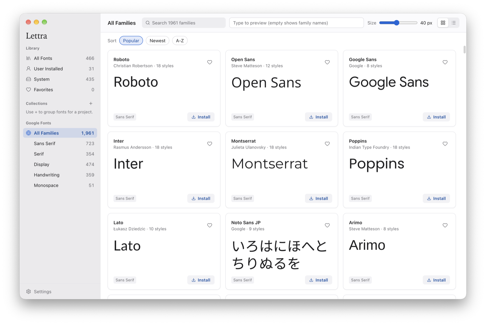
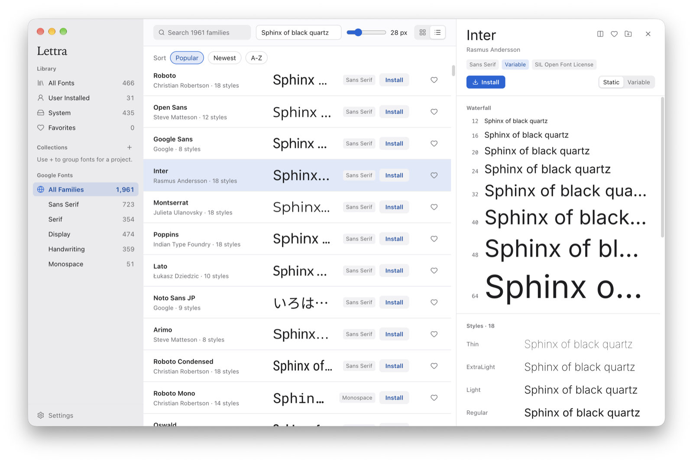
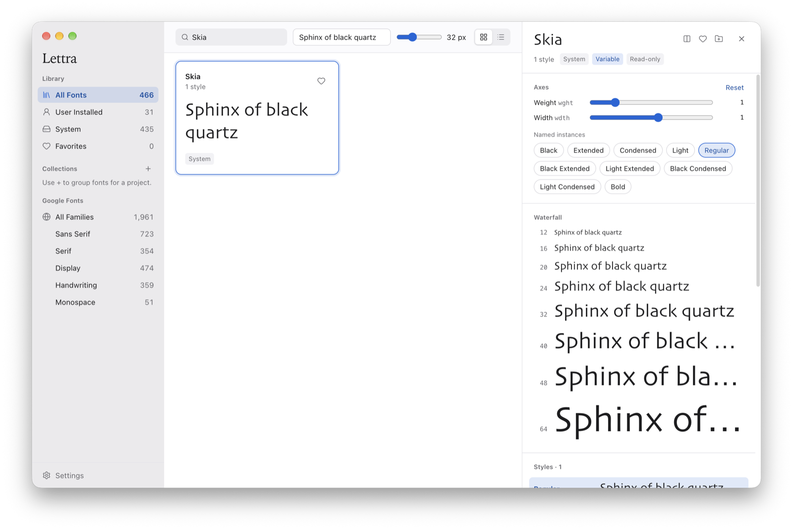
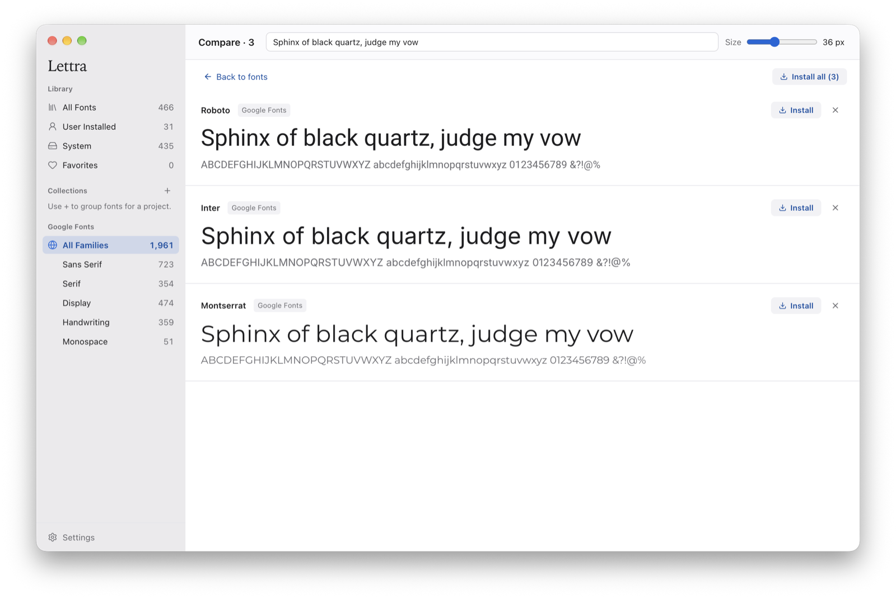

# Lettra

A font manager for macOS. It shows the fonts installed on your Mac and the Google Fonts catalog in the same window, and installs Google families with one click.

[](https://github.com/kr0no/lettra/releases/latest)
[](https://github.com/kr0no/lettra/actions/workflows/ci.yml)
[](LICENSE)

<picture>
  <source media="(prefers-color-scheme: dark)" srcset="docs/screenshots/hero-dark.png">
  
</picture>

## Features

- Local fonts: user, system and Apple's downloadable fonts, including the individual faces inside `.ttc` collections. Duplicates are flagged.
- Around 1,900 Google Fonts families with live previews. Installing puts every style in `~/Library/Fonts/<Family>/`. Lettra can uninstall what it installed and tells you when a family has an update.
- Your own preview text, sizes from 14 to 72 px, grid or list view.
- A detail panel with a waterfall, every style, sliders for variable font axes and named instances, the full glyph set grouped by Unicode block, and file info.
- Compare up to 4 families side by side (⌘-click a card to pin it).
- Favorites and collections, mixing local and Google fonts.
- Drag font files or folders onto the window to install them.
- Works offline with a bundled copy of the Google catalog.
- English and Spanish, light and dark mode, keyboard navigation.

System fonts are read-only. Lettra only removes fonts that live in your user font folder, and removed files go to the Trash.

<p>
  
  
</p>



## Install

Download `Lettra-<version>-universal.dmg` from the [releases page](https://github.com/kr0no/lettra/releases/latest), open it and drag Lettra to Applications. It needs macOS 13 or later and runs on both Apple Silicon and Intel.

The app isn't notarized, so macOS blocks it the first time you open it. To allow it:

- macOS 15 and later: open Lettra once and close the warning. Then go to System Settings > Privacy & Security, scroll down to the message about Lettra and click Open Anyway. Confirm with your password.
- macOS 13 and 14: right-click Lettra.app in Applications, choose Open, then Open again in the dialog.

You only need to do this once. Updates installed from inside Lettra open without asking.

If macOS says the app is damaged and can't be opened, clear the quarantine flag and open it again:

```bash
xattr -dr com.apple.quarantine /Applications/Lettra.app
```

### Updates

Lettra checks GitHub for a new release after launch and once a day. When there is one, a notice shows up at the bottom of the sidebar. Click it and Lettra downloads the new version, checks it against the checksum GitHub publishes and restarts on it. You can turn the check off in Settings.

## Privacy

Lettra has no accounts, analytics or telemetry. It only goes online for the Google Fonts catalog and previews (`fonts.google.com`, `fonts.googleapis.com`, `fonts.gstatic.com`), for variable font files (`raw.githubusercontent.com`), `www.googleapis.com` only if you add an API key in Settings, and to check for updates (`api.github.com`, `github.com`). Offline mode in Settings turns all of that off, and local fonts keep working.

## Your data

Settings, favorites and collections are stored in `~/Library/Application Support/Lettra/`. Uninstalling the app doesn't touch your fonts.

If something goes wrong, open an [issue](https://github.com/kr0no/lettra/issues) and attach `main.log` (Help > Show Logs). It helps a lot.

## Building from source

See [docs/DEVELOPMENT.md](docs/DEVELOPMENT.md).

## Disclaimer

Lettra isn't affiliated with Google or Apple. Google Fonts families keep their own licenses (mostly OFL and Apache 2.0), which the detail panel shows. The catalog endpoint isn't an official API and could change.

## License

[GPL-3.0-or-later](LICENSE), © 2026 kr0no (Aitor F.)
